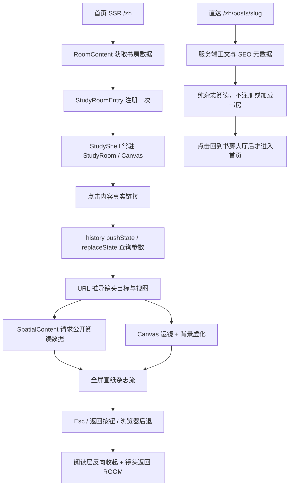

# 3D 常驻书房与空间阅读层重构

## 架构与入口

书房内打开文章、专栏、列表和时间轴时，只更新同一首页的查询参数。该路径不调用 `router.push`，不请求新的页面 RSC 树，也不替换主页组件。`StudyRoom` 固定挂在语言级 `StudyShell` 中；只有顶层阅读内容随所选资源更换。



| 阅读内容 | 书房内浅路由 | 分享、搜索与直达 URL | 镜头物件 |
| --- | --- | --- | --- |
| 文章详情 | `/zh?article=slug` | `/zh/posts/slug` | bookshelf |
| 专栏详情 | `/zh?column=slug` | `/zh/columns/slug` | columns |
| 文章列表 | `/zh?view=posts&page=2` | `/zh/posts?page=2` | bookshelf |
| 专栏列表 | `/zh?view=columns` | `/zh/columns` | columns |
| 时间轴 | `/zh?view=timeline#day-id` | `/zh/timeline#day-id` | diary |
| 作品详情 | `/zh?view=projects&project=id` | `/zh/projects/id` | computer |

物件自身的预览仍用 `?room=diary`、`?room=computer` 等；选中的专栏实体用 `edition` 参数，避免和阅读态 `column` 冲突。分类状态继续放在 `category` 参数中。

直接刷新/分享浅路由时，首页服务端会先将查询参数转换为规范路径，再重定向到可 SSR 的阅读页，不会先准备书房的文章、作品和场景数据。

## 核心修改

### 单一状态源

`src/components/study/study-route.ts` 负责所有 URL 与阅读资源之间的映射。持久视图状态为 `ROOM / DIARY / WORK / ARTICLE / COLLECTION / ALBUM / ABOUT / LINKS`；镜头物件和物件预览均从当前 URL 推导。

`StudyNavigation.tsx` 使用 `useSyncExternalStore` 订阅原生 `popstate` 和浅路由更新通知。`StudyShell` 中单独的小型 `RouteObserver` 处理 Next 的规范路径/参数更新；`useSearchParams` 位于独立 Suspense 边界内，不阻塞直达文章 HTML。

动画阶段 `opening / reading / closing / room` 只控制视觉表现，不保存另外一份目标物件，也不能覆盖 URL。

### 常驻 Canvas 与浅路由

`StudyShell.tsx` 捕获书房内所有符合条件的站内阅读链接。真实 `href` 仍是规范路径，因此复制链接、新标签页、Ctrl/Cmd 点击、外链与下载保留常规行为。

核心写入方式：

```tsx
const state = {
  ...window.history.state,
  __study: { kind: 'magazine', returnToRoom: true },
}
// 首次阅读 push；物件预览/阅读内部切换 replace。
if (replace) window.history.replaceState(state, '', href)
else window.history.pushState(state, '', href)
notifyStudyLocation()
```

必须保留 Next 的原始 history state；不能以 `{}` 覆盖其路由树。常驻房间没有 pathname/query key，`SpatialContent` 才以规范资源路径为 key。

`RoomContent.tsx` 只由首页请求；`StudyRoomEntry.tsx` 提供服务端文字入口并把数据注册到持久 Shell。Shell 只保存第一次注册的数据，返回首页不会因新数据数组引用而重建 Three.js 资源。Three.js 本身仍按需动态导入。

### 运镜、虚化与反向退出

`StudyRoom.tsx` 在 URL 变化时解除暂停，将当前目标交给场景控制器。原先独立的 `active` 状态写入和 `popstate` 恢复逻辑已移除，避免镜头被旧弹层覆盖。

```tsx
controller.current?.setPaused(false)
controller.current?.setTarget(route.target, route.column)
```

`room-scene.ts` 保留物件特写运镜；位置用 `lerpVectors`，旋转用 `slerpQuaternions`，并以当前镜头姿态作为中断后的起点：

```ts
const t = progress * progress * (3 - 2 * progress)
camera.position.lerpVectors(fromPosition, toPosition, t)
camera.quaternion.slerpQuaternions(fromQuaternion, toQuaternion, t)
```

重复选择相同、已经到位的目标会直接通知到位，而不是重启运镜。回到 `ROOM` 时目标为 `null`，从当前位置平滑回退。

`magazine.css` 在运镜时平滑增加底层 Canvas 容器的 `filter: blur(14px)`，阅读层额外使用 `backdrop-filter`；纸面由中心放大并淡入，关闭时保留退出纸面完成收起动画。阅读内容在镜头到位后变为可交互，避免镜头尚未完成就出现内容突变。

场景到位后暂停 RAF 与时钟更新，保留 Canvas/WebGL 资源；退出时恢复，不通过 dispose/remount 实现暂停。相同镜头间连续阅读时，也在到位回调内直接暂停，避免 React 合并状态更新漏掉暂停。

已有轻微翻书/抽书音效延续使用；默认静音，用户开启后才播放。运镜揭示与阅读切换按 URL 去重，日记手动翻页仍可重复发声。

### 历史、Esc 与焦点

由书房开始的一次阅读会话只占一个历史位置：

1. `ROOM → 物件` 新增一个历史位置，物件之间切换替换该位置。
2. `物件 → 杂志` 将物件位置替换成阅读位置，其上一条仍是默认书房。
3. `杂志 → 另一篇文章/专栏` 替换阅读位置。
4. Back / Esc / 返回按钮返回默认书房；Forward 恢复最后阅读资源与对应镜头。

直达的 `?room=` 没有站内前驱时，会先保留一个安全的首页位置再打开阅读。直达规范文章页不会人为插入历史陷阱，返回按钮通过 Next 客户端导航进入首页后再加载书房。

Esc 尊重输入法组合态、已消费的键盘事件与嵌套媒体预览；空间阅读层支持 Tab 焦点循环。打开阅读将焦点移入阅读区，退出完成后恢复原始入口或书房导航。运镜中与关闭中的内容使用 `inert`，不让键盘进入隐藏层。

### 阅读排版与加载错误

- `(site)/layout.tsx` 移除统一 Header、Footer 和顶部占位。
- 文章、专栏、列表和时间轴改用暖纸色、衬线体与留白排版，移除顶部返回列表、浮动目录和卡片框线。
- `PostCard` / `ProjectCard` 增加无边框杂志变体；文章列表不再使用倾斜/聚光卡片。
- `MagazineArticle.tsx` 由规范文章页和空间阅读层共用，保留 Markdown、高亮、专栏归属、前后篇、评论与书签位置记录。
- 评论使用规范文章路径作为稳定标识，浅路由阅读不会把不同文章误合并为首页评论。
- 阅读区域不应用暗色模式 utility，书房夜景与暖纸色阅读互不干扰。
- `PaperLoading.tsx` 提供纸张微动反馈，路由 loading 边界和内容请求均复用。
- `SpatialContent.tsx` 使用 `AbortController`，关闭/切换时取消旧请求；15 秒请求超时和失败均提供纸面内重试，迟到结果不能覆盖新文章。
- `api/study/reading/route.ts` 仅从白名单公开资源加载数据，不接受任意后端 URL；慢 CMS 请求设置超时。
- 文章错误、专栏错误及 404 留在阅读布局内，不销毁底层场景；重试只重新请求内容。
- `prefers-reduced-motion` 同时禁用 CSS 纸面动画和场景运镜插值。

## 验证

自动测试覆盖 URL 映射、物件/阅读切换、Canvas 实例不变、Back/Forward、Esc 打断、迟到镜头回调、异步请求取消、迟到数据和原地重试。原有书房内容、相册、日记、书签等测试继续运行。

执行：

```powershell
npm test
npm run build
```

新增核心模块已通过针对性 ESLint，TypeScript/生产构建通过。生产构建存在仓库原有的 middleware 命名弃用提示，不影响本次构建。

本地真实 Edge 验证：

- 从书架打开真实文章，文档请求数保持 **1 → 1**，页面 RSC 请求数为 **0 → 0**。
- 打开、Back、Forward、Esc 后，Canvas 和 Document 均为原实例；WebGL 上下文丢失次数为 **0**。
- 规范文章链接直达返回 **200**、服务端正文可读，Canvas 数为 **0**。
- 390px 移动端，专栏 → 文章替换同一阅读历史位置，Back 返回 `ROOM`；页面宽度与视口均为 **390px**。
- 注入慢请求与 503 后，纸张加载、纸面错误、原地重试均正常，Canvas 保持原实例。
- 刷新 `?article=` 链接转为规范文章 URL，直接阅读不挂载 Canvas。

以上为本地开发和构建验收，未部署到线上。
