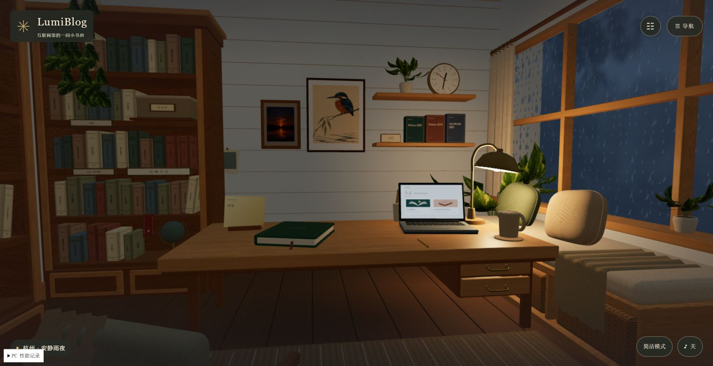

# V2 真实天气联调与 PC 发布验收

2026-11-07 10:24（北京时间），V2 已发布。线上版本为 `39157d3`，[PR #12](https://github.com/Gaylen-Hu/lumiblog/pull/12) 已合并。用户确认保留自动轻量模式，雨夜帧率后续优化。

## 本轮完成

- 用户确认沿用现有天气账号上线；天气 Host/Key 已配置到仓库发布凭据，未进入源码、前端或公开响应。本地常驻服务使用仓库外私有配置。
- 本地 PostgreSQL 16、Redis 7、真实 Nest 环境接口与前端生产构建共同运行。杭州实况、管理员 JWT 保存、数据库 revision、匿名管理访问 401 均通过。
- 修复 Nest 缓存依赖版本不兼容，以及 Redis 连接故障导致冷启动等待的问题。真实 Redis 验证共享读写、过期、失效、锁持有者校验、锁过期、共享退避和多实例故障行为。
- 连续 12 次天气缓存读取保持同一获取时间，本地 P50 1.89 ms、P95 2.86 ms；此为本地热缓存测量，不是公网延迟承诺。
- 增加上游超时保留旧快照、1/5/15 分钟退避及两小时过期测试。
- 发布流程支持前台、API、管理端和单个新增环境表迁移；包含数据库备份验证、迁移白名单、私有天气配置、服务冒烟及失败回退。生产只读检查确认现有 6 项迁移已应用，无失败迁移，备份工具可用。实际生产发布和回退尚未执行。

## 验证结果

| 检查 | 结果 |
| --- | --- |
| 前台完整测试 | 22 个文件、115 项通过；类型、ESLint、生产构建通过 |
| 后端完整测试 | 46 个套件、456 项通过、1 项跳过；生产构建通过 |
| 管理端 | 类型及生产构建通过 |
| 最终完整发布包 | [42251709893](https://github.com/Gaylen-Hu/lumiblog/actions/runs/42251709893) 成功，部署未启用 |
| 独立环境 CI | [42251719588](https://github.com/Gaylen-Hu/lumiblog/actions/runs/42251719588) 成功 |
| PR 前台 CI | [42251718657](https://github.com/Gaylen-Hu/lumiblog/actions/runs/42251718657) 成功 |
| Chrome 阅读回归 | 最终版本 10 次文章打开/返回；阅读时暂停绘制，两个相隔 17 秒的读取绘制计数均为 457；重复切换期间 geometry 202、texture 42 稳定 |
| 预设资源检查 | 较早候选 `d22b298` 的 20 次晴雨切换后资源稳定；不能将该结果视为最终静态合批代码的完整长时测试 |
| Chrome 错误 | 最终检查未捕获 console error；不等同于所有设备无错误 |

## PC 性能：仍未通过

按用户要求，验收先考虑 PC，不再以手机真机验收阻塞发布。开发继续保留窄屏适配。

本机 Chrome：Intel Arc Pro 集成显卡，1536×791 CSS 视口，系统 DPR 2，自动降低渲染比例至 1。请求高性能显卡后仍由 Chrome 选择集成显卡，未修改用户系统显卡设置。

已减少静态阴影重算、合批非交互静态物体、降低雨窗重复采样；静态场景绘制调用由约 499 降至 245，几何资源由约 426 降至 200（打开书架后 202）。合批测试保留交互目标、可动子树及后续可能显示的隐藏物体。

实际雨夜仍触发自动轻量降级。最终会话累计动画采样 514 帧、23.5 FPS，帧间隔 P50/P95 均约 50 ms；期间包含场景切换，不能当成固定场景持续帧率。此前雨夜短测约 16–23 FPS，尚无接近 60 FPS 的达标证据。轻量模式会停止部分环境动画；截图不能证明动画流畅度。

页面停留超过 10 分钟，但包含阅读暂停和设置操作，**不计作十分钟持续雨夜动画稳定性通过**。未完成最终版本完整的长时间动态负载验收。

## 发布状态与下一步

生产发布使用已验证的完整发布包 `42251709893`。数据库备份验证、环境表迁移、前台、API 和管理端切换均已成功。[生产发布记录](https://github.com/Gaylen-Hu/lumiblog/actions/runs/42329006260)

主站和管理端版本均为 `39157d3`。Chrome 首页显示「杭州 · 多云」，与天气接口的有效实况一致。匿名请求管理接口返回 401，生产搜索和阅读检查通过，公网文章阅读接口返回 `kind: article`。

下一步在同一台 PC 上优化雨夜渲染，重新测量持续动画帧率及十分钟运行时的资源用量。

正式分层四季植被、正式雪景、录制雨声及耳机听感仍属于前次记录中的扩展范围，不能随本轮联调通过而宣称已完成。
